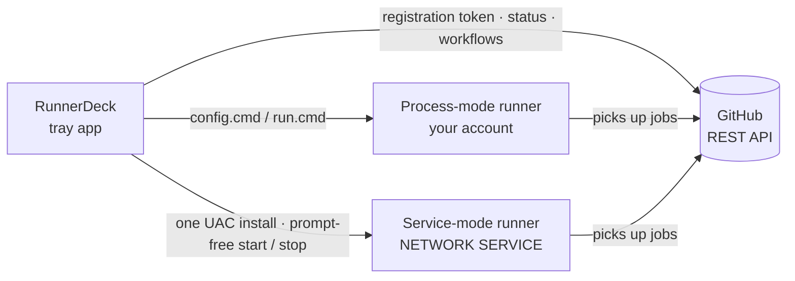

<div align="center">


# RunnerDeck

**Manage GitHub Actions self-hosted runners for many repositories from the Windows tray**

Sign in with one PAT, register a runner in a few steps; start, stop, status, logs and notifications live in the tray.

[](https://github.com/nablejohne/RunnerDeck/releases/latest)
[](https://github.com/nablejohne/RunnerDeck/actions/workflows/ci.yml)
[](https://github.com/nablejohne/RunnerDeck/releases)
[](#quick-start)
[](LICENSE)

[简体中文](README.md) · **English**

[Quick start](#quick-start) · [Features](#features) · [How it works](#how-it-works) · [Process vs service](#modes) · [PAT permissions](#pat) · [FAQ](#faq)

</div>


> [!NOTE]
> The interface is in Simplified Chinese.

> [!WARNING]
> **Be careful with self-hosted runners on public repositories**: anyone's fork PR may run code on your machine. RunnerDeck warns you when adding one; turn on "Require approval for fork pull request workflows" in the repository's Settings → Actions → General.

<a id="features"></a>

## ✨ Features

| | |
| --- | --- |
| 🧭 **Add wizard** | Pick a repository → name and labels → actions/runner is downloaded, SHA256-checked and registered; any failure is rolled back |
| 🖥️ **Lives in the tray** | The icon colour is the status (grey stopped · green idle · blue running a job · red needs attention); launch on login, start runners with RunnerDeck, job success / failure notifications |
| 🛡️ **Service mode** | Run a runner as a Windows service: starts with Windows, no sign-in needed, keeps running when RunnerDeck quits; one UAC prompt, then start / stop without prompts |
| 🔍 **Workflow check** | The detail page lists the repository's jobs that would use this runner and points out labels that do not match (such a job stays queued forever); recent runs too |
| 📜 **Live output and logs** | Live output and the runner's `_diag` logs (redacted); import existing runner directories, take over a runner another process runs |
| 📦 **Install and verify** | Per-user installer, no administrator rights; every release ships `SHA256SUMS.txt` and GitHub build provenance; update check in settings |

<a id="quick-start"></a>

## 🚀 Quick start

1. Download `RunnerDeck-<version>-setup.exe` from [Releases](https://github.com/nablejohne/RunnerDeck/releases/latest) and install it (or unzip the zip and run it).
2. On first start, paste a [fine-grained PAT](https://github.com/settings/personal-access-tokens/new) ([permissions below](#pat)).
3. Click "添加 runner" (add runner), pick a repository, enter labels and, if you like, tick "以 Windows 服务运行" (run as a Windows service).


<a id="how-it-works"></a>

## ⚙️ How it works



RunnerDeck relies on two things only: the GitHub REST API (registration tokens, status) and the runner's own `config.cmd` / `run.cmd`. GitHub is the source of truth for registrations, each runner directory's `.runner` for the local side; the PAT is kept in Windows Credential Manager only.

<a id="modes"></a>

## 🔀 Process mode vs service mode

| | Process (default) | Windows service |
| --- | --- | --- |
| Who runs it | A child process of RunnerDeck, your account | A Windows service, `NETWORK SERVICE` |
| When it runs | While RunnerDeck runs (can start with it) | From boot, no sign-in needed |
| RunnerDeck quits / you sign out | The runner stops gracefully | Not affected |
| Jobs see your profile, PATH, system proxy | ✅ | ❌ (the proxy goes into the runner's `.env`) |
| Administrator rights | Never | One UAC prompt to add / convert / remove |


<a id="pat"></a>

## 🔑 PAT permissions

| Permission | Required | Used for |
| --- | --- | --- |
| Administration: Read and write | ✅ | Registering and removing runners, runner status |
| Contents: Read | Optional | Reading workflows for the label check |
| Actions: Read | Optional | Recent runs on the detail page |

Select the repositories under Repository access on a fine-grained token; a classic token needs `repo`.

<a id="faq"></a>

## ❓ FAQ

<details>
<summary><b>SmartScreen says "unknown publisher"?</b></summary>

The program has no code-signing certificate, so this is expected. Click "More info → Run anyway". You can verify the file first, see the next answer.
</details>

<details>
<summary><b>How do I check that a download has not been tampered with?</b></summary>

```powershell
Get-FileHash .\RunnerDeck-<version>-setup.exe -Algorithm SHA256   # compare with SHA256SUMS.txt in the release
gh attestation verify RunnerDeck-<version>-setup.exe -R nablejohne/RunnerDeck   # built by this repository's GitHub Actions
```
</details>

<details>
<summary><b>What does uninstalling remove?</b></summary>

Only the program and a launch-on-login entry that points to it. Settings (`%APPDATA%\RunnerDeck`), runner directories and the PAT in Credential Manager are kept; service-mode runners do not depend on RunnerDeck and keep running. To clean up completely, remove the runners you no longer need in RunnerDeck first.
</details>

<details>
<summary><b>A service-mode job cannot find Python, uv or other tools?</b></summary>

The service runs as `NETWORK SERVICE`, which cannot read your user profile or use your user PATH. Install the tools system-wide (e.g. under `C:\Program Files`) or use process mode. The runner root must not be inside your profile either.
</details>

<details>
<summary><b>What is the <code>runnerdeck-cli.exe</code> in the UAC prompt?</b></summary>

The one step of service mode that needs administrator rights (installing / removing the service, granting start / stop). It performs a single predefined operation with every argument validated; the request file is deleted once read and expires after 10 minutes. You trust it the same way you would trust running `config.cmd --runasservice` as administrator yourself.
</details>

<details>
<summary><b>I cancelled a sign-out, but the runners did not come back?</b></summary>

Windows 11 closes RunnerDeck as soon as sign-out starts, so it is gone by the time you click "Cancel". Open RunnerDeck again (runners set to start with it will start); use service mode for runners that must survive sign-out.
</details>

<details>
<summary><b>Where are the logs?</b></summary>

RunnerDeck's own logs are in `%LOCALAPPDATA%\RunnerDeck\logs` (open them from settings); each runner's logs are in its `_diag` directory and on the detail page under "诊断日志" (diagnostic logs).
</details>

<details>
<summary><b>Organisation or enterprise runners?</b></summary>

Only repository-level runners for now.
</details>

## 🛠️ Development

<details>
<summary>Run from source, test, package</summary>

Requires Python 3.11 and [uv](https://docs.astral.sh/uv/).

```powershell
uv sync                                   # dependencies
uv run python -m runnerdeck               # run
uv run runnerdeck-cli --help              # command line (troubleshooting)
uv run pytest                             # tests
pwsh scripts/build.ps1                    # zip + setup.exe (needs Inno Setup 6)
uv run python scripts/screenshots.py      # regenerate the README screenshots
```

Plan: [docs/PLAN.md](docs/PLAN.md) · progress: [docs/PROGRESS.md](docs/PROGRESS.md) · measured runner behaviour: [docs/spike-notes.md](docs/spike-notes.md) (in Chinese).
</details>

## 📄 License

[GPL-3.0](LICENSE)
