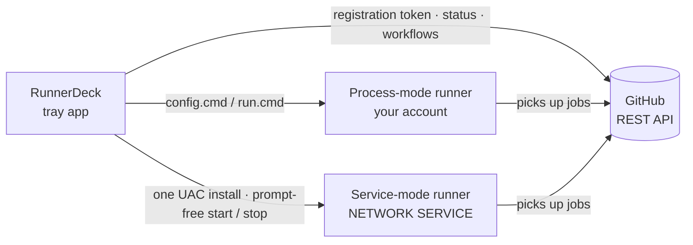

<div align="center">


# RunnerDeck

**Manage GitHub Actions self-hosted runners for many repositories from the Windows tray**

Sign in with one PAT, register a runner in a few steps; start, stop, status, logs and notifications live in the tray.

[](https://github.com/nablejohne/RunnerDeck/releases/latest)
[](https://github.com/nablejohne/RunnerDeck/actions/workflows/ci.yml)
[](https://github.com/nablejohne/RunnerDeck/releases)
[](#quick-start)
[](LICENSE)

[简体中文](README.md) · **English**

[Quick start](#quick-start) · [Use in a repo](#use-in-github) · [Features](#features) · [How it works](#how-it-works) · [Process vs service](#modes) · [PAT permissions](#pat) · [FAQ](#faq)

</div>


> [!NOTE]
> The interface is in Simplified Chinese.

> [!WARNING]
> **Be careful with self-hosted runners on public repositories**: anyone's fork PR may run code on your machine. RunnerDeck warns you when adding one; turn on "Require approval for fork pull request workflows" in the repository's Settings → Actions → General.

<a id="features"></a>

## ✨ Features

| | |
| --- | --- |
| 🧭 **Add wizard** | Pick a repository → name and labels → actions/runner is downloaded, SHA256-checked and registered; any failure is rolled back |
| 🖥️ **Lives in the tray** | The icon colour is the status (grey stopped · green idle · blue running a job · red needs attention); launch on login, start runners with RunnerDeck, job success / failure notifications |
| 🛡️ **Service mode** | Run a runner as a Windows service: starts with Windows, no sign-in needed, keeps running when RunnerDeck quits; one UAC prompt, then start / stop without prompts |
| 🔍 **Workflow check** | The detail page lists the repository's jobs that would use this runner and points out labels that do not match (such a job stays queued forever); recent runs too |
| ⚡ **pip mirror** | Pick the PyPI mirror pip uses in CI (written into the runner's `.env`) and speed-test every mirror with one click |
| 🧾 **Job progress and failures** | The detail page's Job tab shows the steps live; a failed job shows the failed step, the error lines and the whole log, and the card and notification name the failed step |
| 📝 **Edit environment variables** | Edit a runner's `.env` (proxy, git settings, …) right from its card, with save and restart |
| 📜 **Live output and logs** | Live output and the runner's `_diag` logs (redacted); import existing runner directories, take over a runner another process runs |
| 📦 **Install and verify** | Per-user installer, no administrator rights; every release ships `SHA256SUMS.txt` and GitHub build provenance; update check in settings |

<a id="quick-start"></a>

## 🚀 Quick start

1. Download `RunnerDeck-<version>-setup.exe` from [Releases](https://github.com/nablejohne/RunnerDeck/releases/latest) and install it (or unzip the zip and run it).
2. On first start, paste a [fine-grained PAT](https://github.com/settings/personal-access-tokens/new) ([permissions below](#pat)).
3. Click "添加 runner" (add runner), pick a repository, enter labels and, if you like, tick "以 Windows 服务运行" (run as a Windows service).


<a id="use-in-github"></a>

## 📘 Using it from a GitHub repository

Once the runner is added, point a workflow's jobs at it with `runs-on`:

```yaml
name: CI
on:
  push:
    branches: [main]
  workflow_dispatch:

jobs:
  build:
    runs-on: [self-hosted, Windows, X64, my-label]   # my-label: the label you gave the runner
    steps:
      - uses: actions/checkout@v4
      - run: python --version
```

- **Labels**: the runner adds `self-hosted`, `Windows` and `X64` itself. A job goes to a runner that has every label in `runs-on`; add a label of your own and the job only goes to this machine. The detail page's Workflow tab lists which jobs can use the runner and which label is missing.
- **Unlike GitHub-hosted runners**: tools such as Python, Node or PowerShell 7 must be installed on this machine; the default shell is PowerShell; `_work` is kept between runs; one runner runs one job at a time, the rest wait.
- **Environment variables**: the proxy and the pip mirror are set in settings and written into every runner's `.env`; anything else goes in the runner card's "⋯ → 编辑环境变量（.env）" (edit environment variables). Restart the runner for changes to apply.
- **Public repositories**: anyone's fork PR may run code on your machine. Turn on "Require approval for fork pull request workflows" in the repository's Settings → Actions → General, and trigger self-hosted workflows only on `push` / `workflow_dispatch`.

<a id="how-it-works"></a>

## ⚙️ How it works



RunnerDeck relies on two things only: the GitHub REST API (registration tokens, status) and the runner's own `config.cmd` / `run.cmd`. GitHub is the source of truth for registrations, each runner directory's `.runner` for the local side; the PAT is kept in Windows Credential Manager only.

<a id="modes"></a>

## 🔀 Process mode vs service mode

| | Process (default) | Windows service |
| --- | --- | --- |
| Who runs it | A child process of RunnerDeck, your account | A Windows service, `NETWORK SERVICE` |
| When it runs | While RunnerDeck runs (can start with it) | From boot, no sign-in needed |
| RunnerDeck quits / you sign out | The runner stops gracefully | Not affected |
| Jobs see your profile, PATH, system proxy | ✅ | ❌ (the proxy goes into the runner's `.env`) |
| Administrator rights | Never | One UAC prompt to add / convert / remove |


<a id="pat"></a>

## 🔑 PAT permissions

| Permission | Required | Used for |
| --- | --- | --- |
| Administration: Read and write | ✅ | Registering and removing runners, runner status |
| Contents: Read | Optional | Reading workflows for the label check |
| Actions: Read | Optional | Recent runs and the Job tab (steps and log) on the detail page; the failed step in notifications |

Select the repositories under Repository access on a fine-grained token; a classic token needs `repo`.

<a id="faq"></a>

## ❓ FAQ

<details>
<summary><b>SmartScreen says "unknown publisher"?</b></summary>

The program has no code-signing certificate, so this is expected. Click "More info → Run anyway". You can verify the file first, see the next answer.
</details>

<details>
<summary><b>How do I check that a download has not been tampered with?</b></summary>

```powershell
Get-FileHash .\RunnerDeck-<version>-setup.exe -Algorithm SHA256   # compare with SHA256SUMS.txt in the release
gh attestation verify RunnerDeck-<version>-setup.exe -R nablejohne/RunnerDeck   # built by this repository's GitHub Actions
```
</details>

<details>
<summary><b>What does uninstalling remove?</b></summary>

Only the program and a launch-on-login entry that points to it. Settings (`%APPDATA%\RunnerDeck`), runner directories and the PAT in Credential Manager are kept; service-mode runners do not depend on RunnerDeck and keep running. To clean up completely, remove the runners you no longer need in RunnerDeck first.
</details>

<details>
<summary><b>A service-mode job cannot find Python, uv or other tools?</b></summary>

The service runs as `NETWORK SERVICE`, which cannot read your user profile or use your user PATH. Install the tools system-wide (e.g. under `C:\Program Files`) or use process mode. The runner root must not be inside your profile either.
</details>

<details>
<summary><b>What is the <code>runnerdeck-cli.exe</code> in the UAC prompt?</b></summary>

The one step of service mode that needs administrator rights (installing / removing the service, granting start / stop). It performs a single predefined operation with every argument validated; the request file is deleted once read and expires after 10 minutes. You trust it the same way you would trust running `config.cmd --runasservice` as administrator yourself.
</details>

<details>
<summary><b>I cancelled a sign-out, but the runners did not come back?</b></summary>

Windows 11 closes RunnerDeck as soon as sign-out starts, so it is gone by the time you click "Cancel". Open RunnerDeck again (runners set to start with it will start); use service mode for runners that must survive sign-out.
</details>

<details>
<summary><b>Where are the logs?</b></summary>

RunnerDeck's own logs are in `%LOCALAPPDATA%\RunnerDeck\logs` (open them from settings); each runner's logs are in its `_diag` directory and on the detail page under "诊断日志" (diagnostic logs).
</details>

<details>
<summary><b>Organisation or enterprise runners?</b></summary>

Only repository-level runners for now.
</details>

### CI troubleshooting

<details>
<summary><b>A job stays at "Waiting for a runner"?</b></summary>

- Check that the runner is online in RunnerDeck (green or blue).
- Check that it has every label in `runs-on`: detail page → Workflow tab names the missing one.
- If you added the label later: GitHub matches runners only when a job is queued, so cancel the queued job and run it again.
</details>

<details>
<summary><b>checkout fails with <code>unable to access 'https://github.com/...': Connection was reset</code>?</b></summary>

The machine cannot reach github.com directly. A browser works because it uses the system proxy, but git and the runner do not read it. Enter the proxy in Settings → 代理 (proxy), e.g. a local proxy app's `http://127.0.0.1:10808`; it goes into every runner's `.env` and applies after a restart of the runner.
</details>

<details>
<summary><b>Steps with <code>shell: pwsh</code> cannot find pwsh?</b></summary>

Windows ships Windows PowerShell 5.1; `pwsh` is PowerShell 7 and has to be installed (machine-wide MSI, or `winget install --id Microsoft.PowerShell`). Afterwards **quit RunnerDeck from the tray and start it again**: process-mode runners inherit RunnerDeck's PATH, so restarting only the runner does not see the new program. For a service runner, restart the service.
</details>

<details>
<summary><b><code>actions/setup-python</code> fails the first time it installs Python?</b></summary>

On a self-hosted Windows runner, setup-python needs administrator rights the first time it installs a Python version, and a process-mode runner has none. Install it once as administrator; later runs use the cache and need no rights:

1. Download `python-<version>-win32-x64.zip` from [actions/python-versions](https://github.com/actions/python-versions/releases) and unzip it into an empty folder.
2. In an **administrator** PowerShell, go to that folder, point the tool cache at the runner's `_work\_tool` and run `setup.ps1`:

   ```powershell
   $env:RUNNER_TOOL_CACHE = "D:\runners\<runner folder>\_work\_tool"
   .\setup.ps1
   ```

3. It is done when `_work\_tool\Python\<version>\x64.complete` exists.
</details>

<details>
<summary><b>checkout ends with <code>EBUSY: resource busy or locked, rmdir '…\_work\_temp\…'</code>?</b></summary>

Git on this machine has `core.fsmonitor` on (an option of the Git for Windows installer): the fsmonitor daemon started during checkout holds its temporary folder. Add these lines in the runner card's "⋯ → 编辑环境变量（.env）" to turn fsmonitor off for this runner's jobs only (your own git is not affected), save, and restart the runner:

```
GIT_CONFIG_COUNT=1
GIT_CONFIG_KEY_0=core.fsmonitor
GIT_CONFIG_VALUE_0=false
```
</details>

<details>
<summary><b>pip installs dependencies very slowly?</b></summary>

PyPI mirrors throttle some networks hard (measured on one machine: Aliyun 0.4 MB/s, Tencent 28 MB/s). In Settings → pip 镜像源 (pip mirror), click 测速 (speed test) and pick the fastest; it is written into every runner's `.env` as `PIP_INDEX_URL`, which pip prefers over the machine's `pip.ini`, and applies after a restart of the runner.
</details>

## 🛠️ Development

<details>
<summary>Run from source, test, package</summary>

Requires Python 3.11 and [uv](https://docs.astral.sh/uv/).

```powershell
uv sync                                   # dependencies
uv run python -m runnerdeck               # run
uv run runnerdeck-cli --help              # command line (troubleshooting)
uv run pytest                             # tests
pwsh scripts/build.ps1                    # zip + setup.exe (needs Inno Setup 6)
uv run python scripts/screenshots.py      # regenerate the README screenshots
```

Plan: [docs/PLAN.md](docs/PLAN.md) · progress: [docs/PROGRESS.md](docs/PROGRESS.md) · measured runner behaviour: [docs/spike-notes.md](docs/spike-notes.md) (in Chinese).
</details>

## 📄 License

[GPL-3.0](LICENSE)
