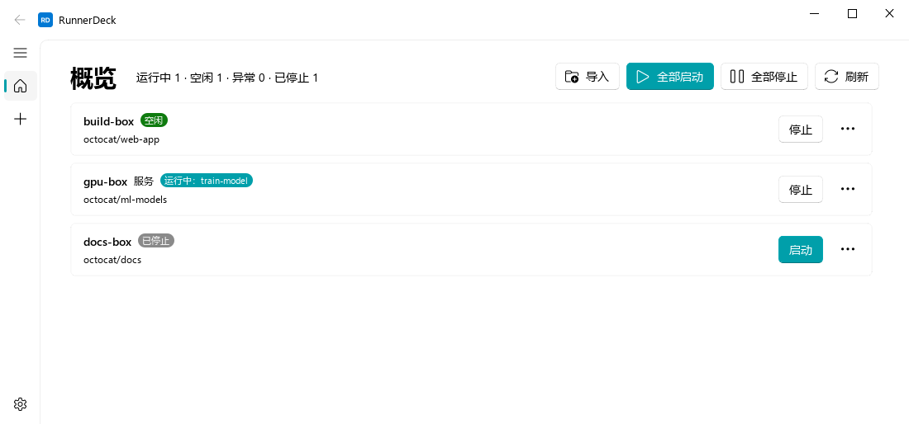
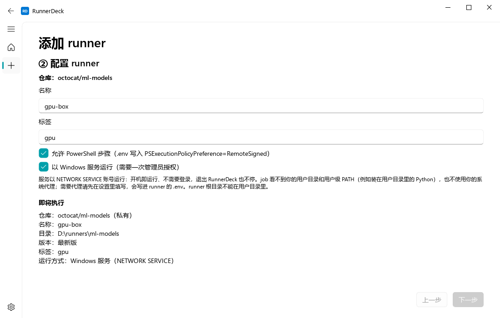
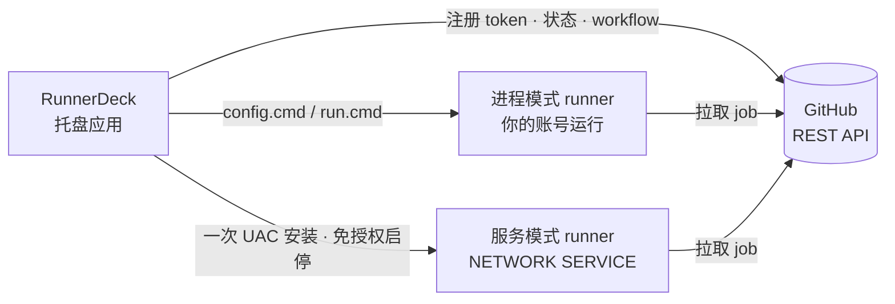
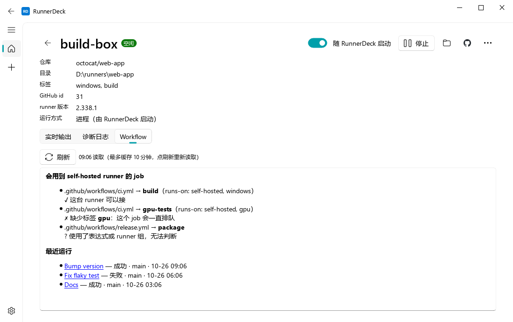

<div align="center">


# RunnerDeck

**在 Windows 托盘里管理多个仓库的 GitHub Actions 自托管 runner**

一个 PAT 登录，几步向导注册；启停、状态、日志、通知都在托盘里。

[](https://github.com/nablejohne/RunnerDeck/releases/latest)
[](https://github.com/nablejohne/RunnerDeck/actions/workflows/ci.yml)
[](https://github.com/nablejohne/RunnerDeck/releases)
[](#quick-start)
[](LICENSE)

**简体中文** · [English](README.en.md)

[快速开始](#quick-start) · [在仓库里使用](#use-in-github) · [功能](#features) · [工作原理](#how-it-works) · [进程 vs 服务](#modes) · [PAT 权限](#pat) · [FAQ](#faq)

</div>



> [!WARNING]
> **公开仓库慎用自托管 runner**：任何人提交的 fork PR 都可能在你的电脑上执行代码。添加 runner 时 RunnerDeck 会提醒；请在仓库 Settings → Actions → General 打开“fork PR 的工作流需要批准”。

<a id="features"></a>

## ✨ 功能

| | |
| --- | --- |
| 🧭 **添加向导** | 选仓库 → 填名称和标签 → 自动下载 actions/runner、校验 SHA256、注册；失败自动回滚 |
| 🖥️ **托盘常驻** | 图标颜色即状态（灰 停止 · 绿 空闲 · 蓝 运行 job · 红 异常）；开机自启，runner 随 RunnerDeck 启动；job 成功 / 失败通知 |
| 🛡️ **服务模式** | 以 Windows 服务运行：开机即运行、不需要登录、退出 RunnerDeck 也不停；只需一次 UAC，之后启停不再弹窗 |
| 🔍 **Workflow 检查** | 详情页列出仓库里会用到这台 runner 的 job，标签对不上（job 会一直排队）直接指出；附最近运行记录 |
| ⚡ **pip 镜像源** | 设置页选 CI 里 pip 用的源（写进 runner 的 `.env`），一键测速各个源，挑最快的 |
| 🧾 **Job 进度与失败原因** | 详情页 Job 页签实时显示步骤；job 失败后直接给出失败步骤、错误行和完整日志，卡片和通知也会写出是哪一步失败 |
| 📝 **编辑环境变量** | 在 runner 卡片上直接编辑它的 `.env`（代理、git 配置等），可以保存并重启 |
| 📜 **实时输出与日志** | 实时输出、`_diag` 诊断日志（已脱敏）；导入已有 runner 目录、接管其他进程运行的 runner |
| 📦 **安装与校验** | 按用户安装，不需要管理员；每个版本附 `SHA256SUMS.txt` 和 GitHub 构建来源证明；设置页检查更新 |

<a id="quick-start"></a>

## 🚀 快速开始

1. 到 [Releases](https://github.com/nablejohne/RunnerDeck/releases/latest) 下载 `RunnerDeck-<版本>-setup.exe` 并安装（或下载 zip 解压即用）。
2. 首次启动粘贴一个 [fine-grained PAT](https://github.com/settings/personal-access-tokens/new)（[权限见下](#pat)）。
3. 点“添加 runner”，选仓库、填标签，需要的话勾选“以 Windows 服务运行”。



<a id="use-in-github"></a>

## 📘 在 GitHub 仓库里使用

runner 添加好之后，在仓库里写一个 workflow，用 `runs-on` 把 job 指到这台机器：

```yaml
name: CI
on:
  push:
    branches: [main]
  workflow_dispatch:

jobs:
  build:
    runs-on: [self-hosted, Windows, X64, my-label]   # my-label 换成添加 runner 时填的标签
    steps:
      - uses: actions/checkout@v4
      - run: python --version
```

- **标签**：`self-hosted`、`Windows`、`X64` 由 runner 自动带上。`runs-on` 里的每个标签 runner 都要有，job 才会派给它；加一个自己的标签，job 就只去这台机器。详情页的 Workflow 页签会列出哪些 job 能用这台 runner、缺哪个标签。
- **和 GitHub 托管 runner 的区别**：Python、Node、PowerShell 7 等工具要自己装在这台机器上；默认 shell 是 PowerShell；`_work` 目录在两次运行之间会保留；一台 runner 同一时间只跑一个 job，其余排队。
- **环境变量**：代理、pip 镜像源在设置里改，会写进每台 runner 的 `.env`；其他变量在 runner 卡片的“⋯ → 编辑环境变量（.env）”里改。都要重启 runner 才生效。
- **公开仓库**：任何人的 fork PR 都可能在你的机器上执行代码。在仓库 Settings → Actions → General 打开 “Require approval for fork pull request workflows”，用自托管 runner 的 workflow 只用 `push`、`workflow_dispatch` 触发。

<a id="how-it-works"></a>

## ⚙️ 工作原理



RunnerDeck 只用两样东西：GitHub REST API（取注册 token、查状态）和 runner 自带的 `config.cmd` / `run.cmd`。注册关系以 GitHub 为准，本地以每个 runner 目录的 `.runner` 为准；PAT 只存在 Windows 凭据管理器。

<a id="modes"></a>

## 🔀 进程模式 vs 服务模式

| | 进程（默认） | Windows 服务 |
| --- | --- | --- |
| 谁在运行 | RunnerDeck 启动的子进程，你的账号 | Windows 服务，`NETWORK SERVICE` |
| 什么时候运行 | RunnerDeck 运行时（可随它自动启动） | 开机即运行，不需要登录 |
| 退出 RunnerDeck / 注销 | runner 优雅停止 | 不受影响 |
| job 能用你的用户目录、PATH、系统代理 | ✅ | ❌（代理写进 runner 的 `.env`） |
| 管理员授权 | 不需要 | 添加 / 转换 / 移除时各一次 UAC |



<a id="pat"></a>

## 🔑 PAT 权限

| 权限 | 必需 | 用途 |
| --- | --- | --- |
| Administration: Read and write | ✅ | 注册、注销 runner，查询 runner 状态 |
| Contents: Read | 可选 | 详情页读取 workflow，检查标签 |
| Actions: Read | 可选 | 详情页的最近运行记录、Job 页签（步骤和日志）、失败通知里的失败步骤 |

Fine-grained token 在 Repository access 里选中要用的仓库；classic token 勾选 `repo` 即可。

<a id="faq"></a>

## ❓ FAQ

<details>
<summary><b>打开时 SmartScreen 提示“未知发布者”？</b></summary>

程序没有代码签名证书，属正常。点“更多信息 → 仍要运行”。运行前可以先按下一条校验文件。
</details>

<details>
<summary><b>怎么确认下载的文件没被篡改？</b></summary>

```powershell
Get-FileHash .\RunnerDeck-<版本>-setup.exe -Algorithm SHA256   # 与 Release 里的 SHA256SUMS.txt 对照
gh attestation verify RunnerDeck-<版本>-setup.exe -R nablejohne/RunnerDeck   # 确认由本仓库的 GitHub Actions 构建
```
</details>

<details>
<summary><b>卸载会删掉什么？</b></summary>

只删程序本身和指向它的开机自启项。设置（`%APPDATA%\RunnerDeck`）、runner 目录、凭据管理器里的 PAT 都保留；服务模式的 runner 不依赖 RunnerDeck，卸载后仍在运行。要彻底清理，先在 RunnerDeck 里“移除”不需要的 runner。
</details>

<details>
<summary><b>服务模式的 job 找不到 Python / uv 等工具？</b></summary>

服务以 `NETWORK SERVICE` 运行，读不到你的用户目录，也拿不到用户级 PATH。把需要的工具装到系统级位置（如 `C:\Program Files`），或改用进程模式。runner 根目录也不能放在用户目录里。
</details>

<details>
<summary><b>UAC 弹出的 <code>runnerdeck-cli.exe</code> 是什么？</b></summary>

服务模式需要管理员权限的那一步（安装 / 移除服务、授权启停）。它只执行一条预先定义的操作，参数逐项校验，请求文件读完即删、超过 10 分钟作废。信任前提与手动以管理员身份运行 `config.cmd --runasservice` 相同。
</details>

<details>
<summary><b>注销时点了“取消”，runner 没有恢复？</b></summary>

Windows 11 一开始注销就会关闭 RunnerDeck，等你点“取消”时它已经不在了。重新打开 RunnerDeck 即可（设为随它启动的 runner 会跟着启动）；不想受注销影响的 runner 用服务模式。
</details>

<details>
<summary><b>日志在哪里？</b></summary>

RunnerDeck 的日志在 `%LOCALAPPDATA%\RunnerDeck\logs`（设置页“日志目录”可直接打开）；runner 自己的日志在 runner 目录的 `_diag`，详情页“诊断日志”可直接查看。
</details>

<details>
<summary><b>支持组织级 / 企业级 runner 吗？</b></summary>

目前只支持仓库级 runner。
</details>

### CI 常见问题

<details>
<summary><b>job 一直显示 “Waiting for a runner”？</b></summary>

- 先看 RunnerDeck 里这台 runner 是否在线（绿色或蓝色）。
- 再看 `runs-on` 里的标签 runner 是不是都有：详情页 → Workflow 页签会指出缺哪个。
- 标签是后来才加的：GitHub 只在 job 入队时匹配 runner，已经在排队的 job 要取消后重新触发。
</details>

<details>
<summary><b>checkout 报 <code>unable to access 'https://github.com/...': Connection was reset</code>？</b></summary>

这台机器直连不上 github.com。浏览器能打开是因为走了系统代理，但 git 和 runner 不读系统代理。在“设置 → 代理”填上代理地址（例如本机代理软件的 `http://127.0.0.1:10808`），它会写进每台 runner 的 `.env`，重启 runner 后生效。
</details>

<details>
<summary><b><code>shell: pwsh</code> 的步骤报找不到 pwsh？</b></summary>

Windows 自带的是 Windows PowerShell 5.1，`pwsh` 是 PowerShell 7，要另外安装（系统级 MSI，或 `winget install --id Microsoft.PowerShell`）。装完要从托盘**完全退出 RunnerDeck 再打开**：进程模式的 runner 从 RunnerDeck 继承 PATH，只重启 runner 看不到新装的程序。服务模式的 runner 重启服务即可。
</details>

<details>
<summary><b><code>actions/setup-python</code> 第一次安装 Python 失败？</b></summary>

在自托管 Windows runner 上，setup-python 第一次装某个 Python 版本需要管理员权限，进程模式的 runner 没有。用管理员身份预装一次，之后直接用缓存，不再需要管理员：

1. 从 [actions/python-versions](https://github.com/actions/python-versions/releases) 下载对应版本的 `python-<版本>-win32-x64.zip`，解压到一个空目录。
2. 在**管理员** PowerShell 里进入解压目录，把 tool cache 指向 runner 的 `_work\_tool` 后运行 `setup.ps1`：

   ```powershell
   $env:RUNNER_TOOL_CACHE = "D:\runners\<runner 目录>\_work\_tool"
   .\setup.ps1
   ```

3. 出现 `_work\_tool\Python\<版本>\x64.complete` 就装好了。
</details>

<details>
<summary><b>checkout 收尾时报 <code>EBUSY: resource busy or locked, rmdir '…\_work\_temp\…'</code>？</b></summary>

这台机器的 git 开了 `core.fsmonitor`（安装 Git for Windows 时的一个选项）：checkout 期间启动的 fsmonitor 守护进程占住了它的临时目录。在 runner 卡片的“⋯ → 编辑环境变量（.env）”里加三行，只对这台 runner 的 job 关掉 fsmonitor，不影响你自己用的 git，保存后重启 runner：

```
GIT_CONFIG_COUNT=1
GIT_CONFIG_KEY_0=core.fsmonitor
GIT_CONFIG_VALUE_0=false
```
</details>

<details>
<summary><b>pip 装依赖很慢？</b></summary>

国内 PyPI 镜像对不同网络的限速差别很大（同一台机器实测：阿里云 0.4 MB/s，腾讯云 28 MB/s）。在“设置 → pip 镜像源”点“测速”，选最快的那个；它会作为 `PIP_INDEX_URL` 写进每台 runner 的 `.env`，优先于机器上的 `pip.ini`，重启 runner 后生效。
</details>

## 🛠️ 开发

<details>
<summary>从源码运行、测试、打包</summary>

需要 Python 3.11 和 [uv](https://docs.astral.sh/uv/)。

```powershell
uv sync                                   # 安装依赖
uv run python -m runnerdeck               # 运行
uv run runnerdeck-cli --help              # 命令行（排障用）
uv run pytest                             # 测试
pwsh scripts/build.ps1                    # 打包 zip + setup.exe（需要 Inno Setup 6）
uv run python scripts/screenshots.py      # 重新生成 README 截图
```

方案见 [docs/PLAN.md](docs/PLAN.md)，进度见 [docs/PROGRESS.md](docs/PROGRESS.md)，runner 实测结论见 [docs/spike-notes.md](docs/spike-notes.md)。
</details>

## 📄 许可

[GPL-3.0](LICENSE)
